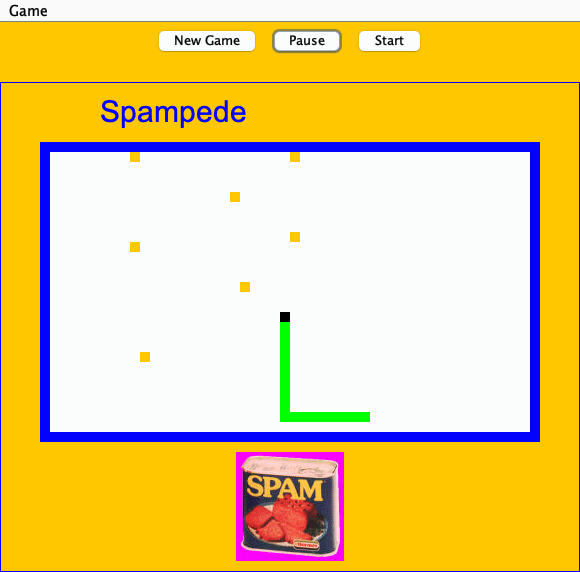

# Spampede

A Snake-style arcade game in Java Swing, with an AI autopilot that uses breadth-first search to steer the snake to the nearest spam by itself.

<p align="center">
  
</p>

You steer a snake around a walled 50 × 30 grid. Spam appears at random, each piece you eat makes the snake one cell longer, and hitting a wall or your own body ends the game. Press `a` and the game plays itself, finding the shortest route to the nearest spam before every move.

**Built with:** Java · Swing / Java2D · JUnit. There are no dependencies beyond the JDK; JUnit is bundled in `lib/` for the tests.

## Features

- **BFS autopilot.** The shortest path to the nearest spam is recomputed before every move, so the AI adapts as new spam appears and the snake's body shifts.
- **Reverse.** Swap the head and tail instantly to get out of a dead end.
- **Growth and collisions.** Eating spam grows the snake; walls and the snake's own body end the game.
- **Model–View–Controller design.** Game rules, rendering, and input handling live in separate classes.
- **Tested.** 65 JUnit tests cover cells, movement, growth, reversal, and the BFS search.

## Controls

| Key / control | Action |
|---|---|
| **Start** | Start or resume the game |
| **Pause** | Pause the game |
| **New Game** | Reset the board and start right away |
| `i` `j` `k` `l` | Move up · left · down · right |
| `a` | Switch to AI mode (BFS autopilot); any direction key or `r` takes back control |
| `r` | Reverse the snake |
| `s` | Play the "Spam" sound |

New Game, Pause, and Start are also in the **Game** menu. Letter keys are lowercase only, so keep Caps Lock off.

## Getting started

**Requirements:** JDK 11 or newer (developed and tested on JDK 21).

Run every command from the repository root. The game loads its sounds and image from `media/` using relative paths.

**Play**

```bash
javac -d bin src/main/java/com/gradescope/hw10/*.java
java -cp bin com.gradescope.hw10.SpampedeController
```

Click **Start**, then steer with the keyboard.

**Run the tests**

```bash
javac -d bin -cp lib/junit-platform-console-standalone-1.14.1.jar \
  src/main/java/com/gradescope/hw10/*.java src/test/java/com/gradescope/hw10/*.java
java -jar lib/junit-platform-console-standalone-1.14.1.jar execute --class-path bin --scan-class-path
```

**VS Code:** with the Extension Pack for Java installed, open the folder and run `main` in `SpampedeController.java`, or run the tests from the Testing panel.

## Project structure

```text
.
├── src/main/java/com/gradescope/hw10/
│   ├── SpampedeController.java   # input handling, game loop, sound, main()
│   ├── SpampedeModel.java        # game state, rules, AI
│   ├── SpampedeView.java         # rendering
│   ├── BoardCell.java            # one grid cell
│   ├── Preferences.java          # speed, colors, and other constants
│   └── ...                       # supporting enums and the Swing panel
├── src/test/java/com/gradescope/hw10/   # JUnit tests
├── media/                        # sounds and image used by the game
└── lib/                          # bundled JUnit console launcher
```

## Limitations

The autopilot is greedy. It always takes the shortest path to the nearest spam and doesn't plan around its own growing body, so a long snake can eventually box itself in. A natural next step is a safety check, such as taking a path only if the tail is still reachable once the snake gets there.
